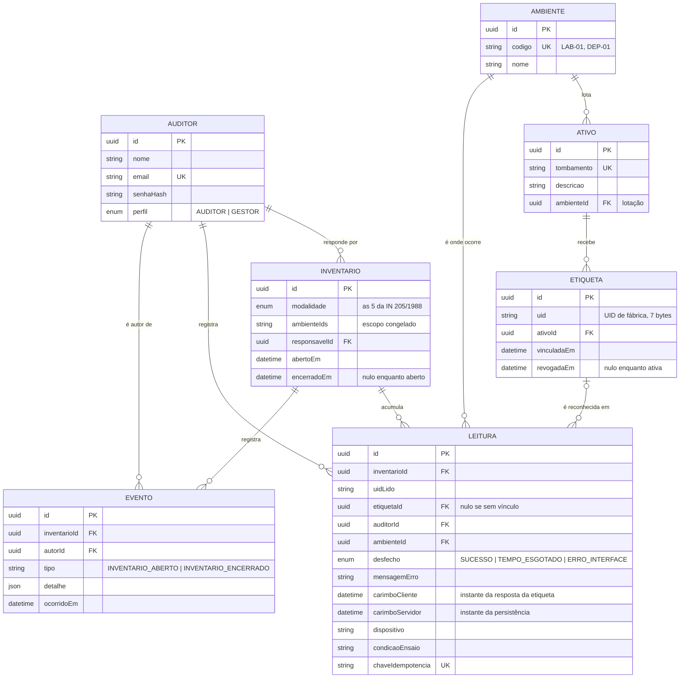

# Auditoria e inventário de patrimônio por NFC

Protótipo do artigo **Tecnologias RFID/NFC e IoT aplicadas à auditoria e ao
inventário de patrimônio** — Faculdade Impacta de Tecnologia, 2026.

Sistema de auditoria patrimonial cuja captura de dados depende
**exclusivamente de software**: nenhum leitor dedicado, nenhum circuito
montado. A leitura acontece no rádio NFC do próprio smartphone do auditor,
exposto ao navegador pela interface Web NFC.

## Por que NFC e não RFID UHF

O RFID em frequência ultraelevada lê dezenas de etiquetas de um corredor
inteiro à distância. Isso é excelente para conferir saldo e inútil como
evidência de auditoria: capturar etiquetas de longe não comprova que alguém
inspecionou cada bem.

O NFC exige aproximação abaixo de 10 cm. O alcance curto, que a literatura
trata como limitação, é aqui a **garantia de que o auditor esteve fisicamente
diante do ativo**. E o leitor, que no UHF é um equipamento dedicado de custo
elevado, passa a ser o aparelho que o auditor já tem no bolso.

## Arquitetura

```
┌─ percepção física ──────────────────────────────────────────────┐
│  etiqueta adesiva de 25 mm compatível com NTAG213               │
│  ISO/IEC 14443-3A · NFC Forum Type 2 · 13,56 MHz · UID 7 bytes  │
│  smartphone Android 10+ · Chrome 89+ · antena NFC nativa        │
└──────────────────────────────┬──────────────────────────────────┘
                               │ UID lido
┌─ aplicação (cliente) ────────▼──────────────────────────────────┐
│  PWA · TypeScript · React · Next.js                             │
│  Web NFC (NDEFReader) em contexto seguro HTTPS                  │
│  fila offline em IndexedDB · service worker · conferência       │
└──────────────────────────────┬──────────────────────────────────┘
                               │ POST /inventarios/{id}/leituras
┌─ serviço e persistência ─────▼──────────────────────────────────┐
│  API REST · Node.js · Express · PostgreSQL · Prisma             │
│  registros imutáveis · trilha de auditoria                      │
└─────────────────────────────────────────────────────────────────┘
```

## Modelo de dados



Quatro decisões do modelo merecem explicação, porque nenhuma é o desenho
óbvio:

**`Leitura` não tem campo de atualização.** Não há `atualizadoEm` porque não
há atualização: correção gera uma nova linha. Uma contagem que pode ser
editada depois não serve como evidência de auditoria.

**`Leitura.etiquetaId` é opcional.** Toda tentativa vira registro, inclusive
quando o UID lido não corresponde a vínculo nenhum. É assim que a apuração
distingue "não cadastrado" de "não localizado", e é dessa coluna que sai a
taxa de leitura incorreta.

**`Etiqueta.uid` não é único na tabela.** Uma etiqueta descolada pode ser
revogada e vinculada de novo, e esse histórico precisa sobreviver. O que é
único é o vínculo *ativo*, garantido por um índice único parcial
(`WHERE revogadaEm IS NULL`) criado na migração — o Prisma não sabe declarar
isso no schema, mas o PostgreSQL aplica.

**`Inventario.ambienteIds` é um array, não uma tabela de junção.** O escopo
de um ciclo encerrado tem de ficar congelado. Com junção, apagar um ambiente
mudaria retroativamente o escopo de um inventário já fechado.

A etiqueta guarda **apenas o UID de fábrica**. O vínculo entre UID e bem vive
no banco, não na etiqueta: gravá-lo nos dois lugares criaria duas versões da
mesma informação, e uma etiqueta recolada em outro bem passaria a contradizer
o cadastro sem que nada acusasse.

## Decisão de projeto que atravessa o código

**Registro de leitura nunca é alterado.** Correção gera um novo registro; o
vínculo entre etiqueta e ativo é revogado, não editado; ciclo encerrado recusa
leitura nova. Isso não é preciosismo: auditoria avalia a confiabilidade do
processo que produziu a contagem, e um registro editável não serve como
evidência.

A consequência aparece em todo lugar — no `schema.prisma` sem campo de
atualização, no `revogadaEm` da etiqueta, na transação de encerramento, no
índice único parcial que admite reaproveitar um UID revogado.

---

# Primeira execução

Pré-requisitos: **Node.js 22** e um **PostgreSQL**. O banco pode ser local em
contêiner (`docker compose up -d banco`) ou hospedado de graça no
[Neon](https://neon.com). Para a conferência de verdade, um **Android com NFC
e Chrome 89 ou superior**.

```bash
# 1. API
cd api
cp .env.example .env            # cole o DATABASE_URL e troque o JWT_SEGREDO
npm install
npx prisma migrate deploy       # cria tabelas e índices
npx prisma generate             # gera o cliente do Prisma
npm run seed                    # auditor, 2 ambientes, 7 ativos

# 2. Cliente
cd ../web
cp .env.local.example .env.local   # normalmente não precisa editar
npm install
```

Login criado pelo seed: `auditor@impacta.edu.br` / `auditoria2026`.

> **Neon:** desligue o *Connection pooling* e remova `&channel_binding=require`
> da URL. O pooler em modo transação quebra o Prisma Migrate.

## Toda vez

São dois processos, **dois terminais abertos ao mesmo tempo**:

```bash
# terminal 1 — API
cd api && npm run dev           # "API ouvindo em :3333"

# terminal 2 — cliente
cd web && npm run dev           # http://localhost:3000
```

Confirme a API abrindo `http://localhost:3333/saude`: tem que devolver
`{"estado":"ok"}`. Se o login disser que não conseguiu falar com a API, é esse
terminal que caiu.

O cliente chama a API pelo caminho `/api`, servido pelo próprio Next, que
repassa para a porta 3333. Mesma origem: sem CORS e sem configurar endereço.

> **Nunca defina `NEXT_PUBLIC_API`.** Com ela o navegador passa a chamar aquele
> endereço diretamente; no celular, `localhost` é o próprio aparelho, e o login
> falha.

## Para testar o modo offline

O service worker só é registrado na versão compilada — em desenvolvimento o
Next troca módulos a quente e um casco em cache serviria arquivos velhos:

```bash
cd web && npm run build && npm start
```

Com a página já carregada, ative o modo avião e recarregue: a aplicação
continua abrindo, as leituras entram na fila local e sobem quando a rede
volta. Chamadas a `/api/*` nunca vêm do cache.

---

# Usando a aplicação

As telas seguem a ordem do procedimento de inventário. Fazer fora de ordem
funciona, mas produz divergência onde não havia.

| Tela | O que faz |
|------|-----------|
| `/` | Login e abertura do ciclo: modalidade e ambiente |
| `/ativos` | Cadastro patrimonial: tombamento, descrição e lotação |
| `/etiquetas` | Vincula o UID da etiqueta ao bem; troca e desvincula |
| `/conferencia` | A conferência em si, com condição de ensaio e fila offline |
| `/trilha` | Histórico do ciclo: eventos e todas as tentativas de leitura |

**1. Cadastrar os bens** em `/ativos`. A lotação define a lista esperada de
cada ciclo e, portanto, o que conta como divergência.

**2. Vincular as etiquetas** em `/etiquetas`. Toque em "Ler e vincular" e
encoste a etiqueta no verso do aparelho, na altura da antena — em geral o
terço superior. Sem vínculo, toda leitura cai em "não cadastrado".

"Trocar etiqueta" revoga o vínculo anterior na mesma transação: o histórico
fica, mas nunca há dois vínculos ativos. "Desvincular" deixa o bem sem
etiqueta e pede dois toques para confirmar.

**3. Abrir o ciclo** em `/`, escolhendo a modalidade — as cinco são as da
Instrução Normativa SEDAP nº 205/1988 — e o ambiente.

**4. Conferir** em `/conferencia`: uma aproximação por bem. Os contadores
mostram lidos, falhas e itens na fila. "Apurar divergências" classifica em
não localizado, localizado em ambiente diverso e não cadastrado.

**5. Encerrar o ciclo**, o que consolida o resultado. A partir daí o servidor
recusa leitura naquele ciclo. A fila local precisa estar vazia antes.

**6. Conferir a trilha** em `/trilha`: quem leu, quando, de que aparelho, com
os dois carimbos de tempo e a latência de cada tentativa, inclusive as que
falharam.

## No celular

A Web NFC só existe em **contexto seguro**. `localhost` conta, mas o celular
não alcança o `localhost` da sua máquina. Em um **terceiro terminal**:

```bash
npx cloudflared tunnel --url http://localhost:3000
```

Ele imprime uma URL `https://algo-aleatorio.trycloudflare.com`. Abra no Chrome
do celular. Um túnel basta: as chamadas à API saem pelo mesmo endereço.

Checklist antes da primeira leitura, em ordem:

1. **NFC ligado** nas configurações do Android.
2. **Chrome**, não Samsung Internet nem Firefox.
3. **URL em `https://`**, a do túnel.
4. **Permissão concedida** — o Chrome pergunta na primeira leitura.
5. **Tela acesa e aba em primeiro plano.** O Android corta o rádio quando a
   tela apaga.
6. **Etiqueta na altura da antena.** Localize com uma etiqueta conhecida e
   marque a posição com fita.

---

# Métricas dos ensaios

A instrumentação faz parte do produto, não é apêndice. Toda tentativa —
inclusive as que falham — grava UID, desfecho, mensagem de erro, carimbo de
tempo do cliente e do servidor, aparelho e condição experimental. São os seis
dados da subseção 3.6 do artigo.

A **condição experimental** é escolhida no seletor no alto de `/conferencia`,
acompanha cada leitura até o banco e é por ela que as métricas são agrupadas.
A escolha fica guardada no aparelho; não é preciso reiniciar nada ao trocar.

```bash
cd api
npm run metricas                # usa o ciclo mais recente
npm run metricas -- <id>        # ou um ciclo específico
```

O comando roda **de dentro de `api/`**, que é onde o cliente do Prisma está
instalado. Ele imprime a tabela e exporta um CSV em `api/ensaios/dados/`, com
uma linha por condição e as colunas do Quadro 4 do artigo: tentativas,
sucessos, taxa de sucesso, taxa de leitura incorreta, latência média e desvio,
tempo por ativo e número de aparelhos.

Antes de uma bateria, **vincule todas as etiquetas que for usar**. A taxa de
leitura incorreta compara o UID lido com os vínculos ativos: etiqueta sem
vínculo entra como erro quando foi falha de preparação.

O protocolo está em [`docs/protocolo-ensaios.md`](docs/protocolo-ensaios.md),
os requisitos em [`docs/requisitos.md`](docs/requisitos.md) e o passo a passo
detalhado em [`docs/como-executar.md`](docs/como-executar.md).

---

# Deixar no ar

## Túnel temporário

É o que o `npx cloudflared tunnel --url http://localhost:3000` faz. A URL muda
a cada execução e o endereço morre junto com o terminal. Serve para ensaio e
demonstração, não para deixar rodando.

## Túnel nomeado

Endereço fixo, com a aplicação ainda rodando na sua máquina. Precisa de conta
Cloudflare e de um domínio apontado para lá, ambos gratuitos:

```bash
cloudflared tunnel login
cloudflared tunnel create auditoria-nfc
cloudflared tunnel route dns auditoria-nfc auditoria.seudominio.com
cloudflared tunnel run --url http://localhost:3000 auditoria-nfc
```

O endereço continua respondendo enquanto a máquina estiver ligada com os três
processos de pé.

## Hospedagem de verdade

Para a aplicação sobreviver ao notebook fechado, são três peças:

| Peça | Onde | Como |
|------|------|------|
| Banco | Neon | já está lá |
| API | Render, Railway ou Fly | build `npm run build`, start `npm start`, raiz `api/` |
| Cliente | Vercel | raiz `web/`, detecta Next sozinho |

No serviço da API, defina `DATABASE_URL` e `JWT_SEGREDO`, e rode
`npx prisma migrate deploy` no primeiro deploy. No projeto da Vercel, defina
`API_INTERNA` com a URL pública da API — é ela que o rewrite `/api/:caminho*`
usa. Mantendo esse caminho, o navegador continua vendo cliente e API na mesma
origem, sem CORS.

Duas ressalvas. O plano gratuito do Render hiberna após inatividade, e a
primeira chamada depois disso leva perto de um minuto — o suficiente para o
login parecer travado. E este caminho está documentado, não exercitado: o
protótipo foi executado localmente com túnel, que é o cenário dos ensaios.

---

# Limites conhecidos

- **Só Chrome para Android 89+.** A Web NFC não existe em iOS nem em desktop.
  Restrição da plataforma, não escolha do projeto, e delimita o escopo.
- **Só NDEF.** A interface não expõe ISO-DEP nem operações de nível inferior.
  Para ler o UID, basta.
- **Rádio bloqueado com a tela apagada.** A conferência exige o aparelho
  desbloqueado e a aba em primeiro plano.
- **Um bem por vez.** Não há leitura simultânea: mil bens são mil
  aproximações. O ganho é de confiabilidade e de evidência, não de velocidade.
- **Compatibilidade entre aparelhos não medida.** Os ensaios usaram um único
  modelo, e a posição da antena varia por fabricante.

## Problemas comuns

| Sintoma | Causa |
|---------|-------|
| `ERR_CONNECTION_REFUSED` em :3333 | O terminal da API não está rodando |
| "Não foi possível falar com a API" no celular | `NEXT_PUBLIC_API` definida no `.env.local` |
| `Can't reach database server` | Banco fora do ar, ou `DATABASE_URL` errado |
| `@prisma/client did not initialize` | Falta rodar `npx prisma generate` |
| Aviso "navegador não expõe a Web NFC" no desktop | Esperado. Só Chrome para Android |
| Mesmo aviso no celular | A página não está em HTTPS. Use o túnel |
| Toda leitura vira "não cadastrado" | As etiquetas não foram vinculadas |
| "este ciclo já foi encerrado" | Esperado. Encerramento é definitivo; abra outro |
| Prisma Migrate falha no Neon | Desligue o *Connection pooling* |
| Mudança no código não aparece no celular | Service worker com a versão antiga: limpe o cache do Chrome |

---

# Autores

Amanda do Carmo Rodrigues da Costa, André Luiz Anastácio Neves,
Guilherme Pereira Martins, Júlia Oliveira de Miranda,
Pedro Henrique de Castro Tirado.

Orientador: Prof. Me. Gilberto Alves Pereira.
